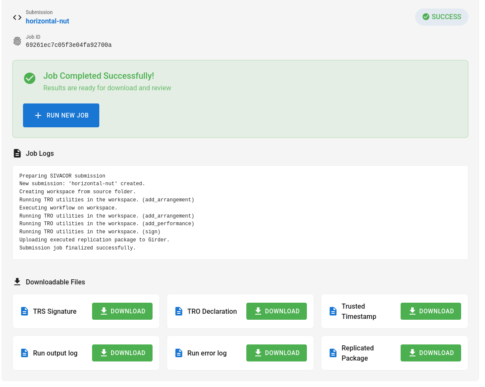
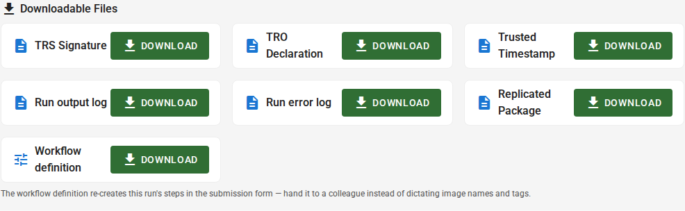
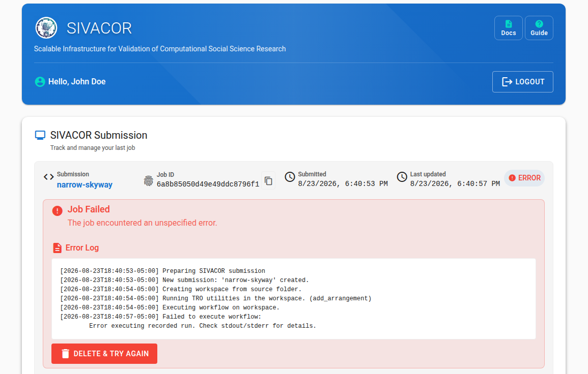
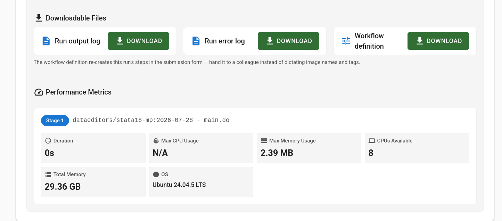

# Downloading Results

Once the job is finished, the submission page reports the outcome and offers the files the run
produced.

(download-success)=
## After a successful run

You can now download the `Replicated Package`, a ZIP file that contains your originally submitted materials, the output files generated by your code, and the TRACE-related files (TRO Declaration, TRS Signature, Trusted Timestamp, see [FAQ](faq.md#downloading-results)) that prove that this job was run on SIVACOR.

The components can also be individually downloaded. 

You can also download a `Workflow definition` — a small YAML file describing the software, versions and main files this run used. It is not part of the signed . It can be used to reproduce the same setup later by importing it on the submission page, instead of filling the form in by hand (see
[Optional chained runs](step2-choosing-image.md#chained-runs-steps)).

## What does a successful SIVACOR run establish?

A SIVACOR Trusted Research Object (TRO) provides a signed record of a particular computational run: the submitted materials, the recorded execution environment and steps, and the files present at recorded stages. Its signature and file checksums allow recipients to verify the record’s origin and whether the accompanying files match that record. This can provide evidence of successful execution and file integrity but it is not sufficient for assessing whether a paper’s findings are fully reproducible.

### Were the results generated during this run?

A file’s presence in the final package does not, by itself, establish that it was generated during execution. If an author-supplied table or figure has the same checksum before and after the run, it may have been left untouched or regenerated identically. A new or changed file establishes a difference between recorded stages, but does not establish that the intended analysis produced it. For example, code could simply copy an existing result.

If this is of concern, you could remove expected output from destination folders or rename the author-provided files. Afterwards, you can check that the expected outputs were created and compare them with the paper. Remember, renaming an existing output helps distinguish files, but does not prevent the code from reading or copying it.

### What does network isolation add?

When enabled for an execution step, network isolation prevents that step from retrieving data, code, or ready-made results over the network. Check the settings for each step as a TRO does not automatically imply that every step was isolated. Isolation also does not establish how materials already included in the package were created.

### What remains outside the certificate’s scope?

A successful run does not establish that:

- Every supplied script or intended analysis was executed.
- The generated tables and figures match those reported in the paper.
- The data are authentic, the code implements the intended methods, or the scientific conclusions are valid.
- Another run will produce identical results on different software or hardware.

The trusted timestamp dates the signed record, rather than proving when each individual result was computed. When reporting a reproduction, distinguish the execution documented by the TRO from your own checks of output generation, agreement with the paper, and any changes made to the authors’ code.

## After a failed run

A failed run does not produce a signed package, only the **`Run output log`** and
the **`Run error log`**. Download those to inspect the detailed reason for failure.

Read the error log first: it will list the command, file or package at fault. The
[debugging guide](debugging.md) covers  common ones per software. The
[FAQ](faq.md#how-do-i-know-a-job-failed) also covers failures that are system faults, not package faults.

:::{tip}

Download both logs before starting a new run. **Starting a new run deletes the previous one**,
logs included.

:::

## Keeping and deleting results

::::{danger}

SIVACOR only briefly retains your results (see [privacy policy](https://submit.sivacor.org/privacy)). To keep your own results, you **must** download results.

::::

::::{danger}

**Starting a new run deletes the previous one.** By clicking the button  `Delete & Run New Job`,  the system implements what the button says. There is no recovery. (Runs are also deleted after 14 days of inactivity.)

::::

## Handing the package to a journal

::::{hint}

You should provide the `Replicated Package` ZIP file to the journal where you are submitting your article.

:::{admonition} AEA Journals
:class: seealso dropdown

For the AEA journals, you should "import" this ZIP file into the AEA's [Data and Code Repository](https://www.icpsr.umich.edu/sites/aea/home) (see [instructions](https://aeadataeditor.github.io/aea-de-guidance/)).

:::

::::

## ℹ️ FAQ

See the [FAQ](faq.md#downloading-results).
